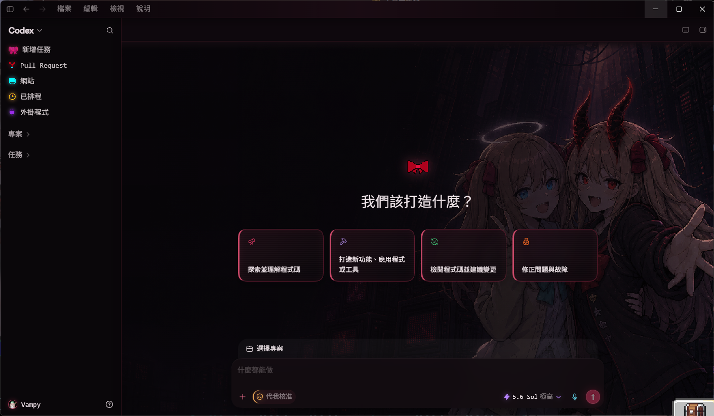
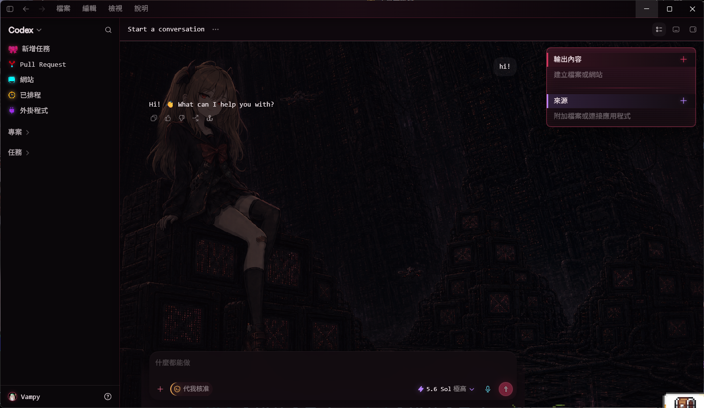
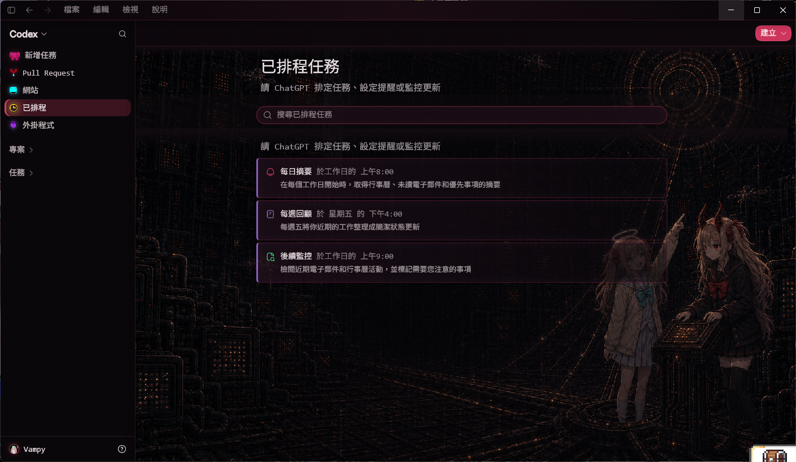

# Codex Neuro Dream Skin

<p align="center">
  <strong>中文</strong> · <a href="#english">English</a>
</p>

Windows 版 Codex 桌面端的非官方 Neuro / Evil Neuro 深色像素主題。它使用本機回環 CDP 注入樣式，不修改官方 Codex 安裝包、`app.asar` 或 WindowsApps 內容。

本專案基於 [Fei-Away/Codex-Dream-Skin](https://github.com/Fei-Away/Codex-Dream-Skin) 修改。

## 版本與分支狀態 / Version and branch status

- Dream Skin 核心固定對齊上游 `v1.4.0`，tag commit：`277b5202bedfda6ae771e2634c4c47877eb6cc87`。
- Neuro / Evil Neuro 視覺擴充版本：`1.21.2`；它只描述本專案的視覺層，不代表核心版本高於 `1.4.0`。
- 本次遷移在獨立分支進行；建立或檢視分支不會修改目前穩定安裝。只有實際執行安裝腳本時，才會更新 `%LOCALAPPDATA%\CodexDreamSkin\engine`，並保留既有主題與使用者資料。
- 上游安全關鍵的安裝、回復、CDP 身分檢查和主題匯入流程保持受管；Neuro 圖像與圖示屬於視覺擴充。

<p align="center">
  
</p>

## 效果展示 / Showcase

<p align="center">
  <br>
  <sub>新任务主页 / New Task home</sub>
</p>

<p align="center">
  <br>
  <sub>任务会话 / Task conversation</sub>
</p>

<p align="center">
  <br>
  <sub>已排程任务 / Scheduled tasks</sub>
</p>

## 特色

- 首頁、任務、Pull Requests、網站、排程與外掛頁面各有獨立背景
- Evil Neuro / Neuro 像素插畫、CRT 面板與高辨識度主題圖示
- 對話載入標誌使用帶三層底座與兩段放電動畫的 Evil Neuro 像素閃電球
- 保留原生 Codex 控件與互動
- 可重複套用，也可一鍵還原

## 需求

- Windows 10 或 11
- Microsoft Store 安裝的官方 Codex 桌面端
- 從原始碼安裝時需要 Node.js 22 或更新版本；Release 安裝包會內建 Node.js
- Windows PowerShell 5.1 或更新版本

## 安裝

> 本專案不提供「直接從網路執行」的一行命令。從原始碼安裝時要先下載完整 repo，但不一定要安裝 Git；安裝器會把經驗證的引擎副本放進 `%LOCALAPPDATA%\CodexDreamSkin\engine`，所以安裝完成後可以移動或刪除下載資料夾。

### 1. 取得專案檔案

選擇其中一種方式：

#### 方法 A：下載 ZIP（不需要 Git）

1. 在 GitHub 頁面按 `Code` → `Download ZIP`，或直接下載 [main 分支 ZIP](https://github.com/vvv017/Codex-Neuro-Dream-Skin/archive/refs/heads/main.zip)。
2. 將 ZIP 解壓到任意可寫入的位置，例如 `Documents\Codex-Neuro-Dream-Skin`。
3. 進入解壓後的資料夾。正確的專案根目錄裡應該能直接看到 `README.md` 和 `windows` 資料夾。
4. 在檔案總管的地址列輸入 `powershell` 並按 Enter，即可在該目錄開啟 PowerShell。

#### 方法 B：Git Clone

在準備長期保存專案的上層目錄執行：

```powershell
git clone https://github.com/vvv017/Codex-Neuro-Dream-Skin.git
Set-Location .\Codex-Neuro-Dream-Skin
```

無論使用哪種方式，都可以先確認目前位置正確：

```powershell
Test-Path ".\windows\scripts\install-dream-skin.ps1"
```

輸出必須是 `True`。若是 `False`，表示 PowerShell 不在專案根目錄，請先 `cd` 到含有 `README.md` 與 `windows` 的資料夾。

### 2. 確認需求

在同一個 PowerShell 視窗執行：

```powershell
node --version
Get-AppxPackage -Name OpenAI.Codex | Select-Object Name, Version
Test-Path "$HOME\.codex\config.toml"
```

- Node.js 必須是 `v22` 或更新版本；找不到 `node` 時，安裝 Node.js 後要重新開啟 PowerShell。
- 第二個命令應列出 Microsoft Store 安裝的 `OpenAI.Codex`。其他安裝來源不受此腳本支援。
- 第三個命令必須輸出 `True`。若是 `False`，請先正常啟動 Codex 一次，等它完成初始化後關閉，再重新檢查。

### 3. 關閉 Codex 並安裝

完全關閉所有 Codex 視窗，再從專案根目錄執行：

```powershell
powershell -NoProfile -ExecutionPolicy RemoteSigned -File ".\windows\scripts\install-dream-skin.ps1"
```

如果腳本提示 Codex 仍在執行，請先在工作管理員結束仍存在的 Codex 程序，再重新執行；安裝器會刻意拒絕在 Codex 運行時修改設定。

安裝器會：

- 驗證 Node.js 與官方 Microsoft Store Codex；
- 將必要腳本與素材原子複製到 `%LOCALAPPDATA%\CodexDreamSkin\engine`；
- 只調整 `%USERPROFILE%\.codex\config.toml` 內的桌面外觀設定，並將安裝前備份保存到 `%LOCALAPPDATA%\CodexDreamSkin`；
- 在桌面和開始功能表建立 `Codex Dream Skin` 啟動捷徑；
- 在桌面建立 `Codex Dream Skin - Restore` 還原捷徑；
- 保留官方 Codex 安裝包、WindowsApps 與 `app.asar`，不會修改它們。

安裝器只複製執行所需的受管引擎，不會複製整個 repo，也不會立刻啟動 Codex。

### 4. 第一次啟動與日常使用

雙擊桌面或開始功能表中的 `Codex Dream Skin`。第一次啟動時請保持 Codex 關閉；捷徑會用僅限本機回環的 CDP 啟動官方 Codex，啟動背景注入器，然後驗證 Skin 是否成功套用。

也可以從專案根目錄手動啟動：

```powershell
powershell -NoProfile -ExecutionPolicy RemoteSigned -File ".\windows\scripts\start-dream-skin.ps1" -PromptRestart
```

若普通 Codex 已經開啟，`-PromptRestart` 會先詢問是否允許重啟；未確認前不會強制關閉。要使用 Skin，之後應從 `Codex Dream Skin` 捷徑啟動，而不是原本的 Codex 捷徑。

### 5. 安裝後可移動原始碼

桌面、開始功能表與托盤捷徑都指向 `%LOCALAPPDATA%\CodexDreamSkin\engine`，不依賴原始下載位置。安裝成功後可以移動或刪除 repo；下次更新時重新 clone／解壓新版，再執行一次安裝命令即可。

### 6. 更新 Skin 或 Codex

如果仍保留 Git Clone，請先完全關閉 Codex，在專案根目錄執行：

```powershell
git pull
powershell -NoProfile -ExecutionPolicy RemoteSigned -File ".\windows\scripts\install-dream-skin.ps1"
```

使用 ZIP 時，請下載新版 ZIP、解壓後從新版專案根目錄重新安裝；安裝成功後可以刪除解壓資料夾。

Microsoft Store 更新 Codex 後，先完全關閉 Codex，再使用 `Codex Dream Skin` 捷徑啟動。啟動器會重新尋找目前註冊的官方版本；若基礎外觀或捷徑也遺失，再重新執行安裝命令。

## 驗證

啟動主題後可輸出驗證截圖：

```powershell
powershell -NoProfile -ExecutionPolicy RemoteSigned -File ".\windows\scripts\verify-dream-skin.ps1" -ScreenshotPath "$PWD\dream-skin-check.png"
```

開發者檢查：

```powershell
powershell -NoProfile -ExecutionPolicy RemoteSigned -File ".\windows\tests\run-tests.ps1"
node --check ".\windows\scripts\injector.mjs"
node --check ".\windows\assets\renderer-inject.js"
```

## 還原

暫時停止 Skin：下面的命令會停止注入器與 CDP；如果 Codex 正在執行，確認後會將它關閉並以普通模式重新開啟。它不會恢復基礎配色，也不會刪除捷徑。

```powershell
powershell -NoProfile -ExecutionPolicy RemoteSigned -File ".\windows\scripts\restore-dream-skin.ps1" -PromptRestart
```

完整還原安裝前的外觀設定並移除所有 Dream Skin 捷徑：

```powershell
powershell -NoProfile -ExecutionPolicy RemoteSigned -File ".\windows\scripts\restore-dream-skin.ps1" -RestoreBaseTheme -Uninstall -PromptRestart
```

## 安全與權利聲明

- CDP 僅綁定 `127.0.0.1`，但同一 Windows 使用者下的其他本機程式仍可能連線；使用主題時只執行可信任軟體。
- 本專案不是 OpenAI 官方產品，也不受 OpenAI 或 Neuro-sama 團隊認可、贊助或背書。
- MIT License 僅涵蓋軟體程式碼；Neuro / Evil Neuro 角色形象與圖片不包含在 MIT 授權內，公開或商業再散布前請自行確認相關權利。

詳細聲明見 [NOTICE.md](./NOTICE.md)。

---

## English

An unofficial dark pixel-art Neuro / Evil Neuro theme for the Windows Codex desktop app. It injects styles through a loopback-only CDP session without modifying the official Codex package, `app.asar`, or WindowsApps files.

Based on [Fei-Away/Codex-Dream-Skin](https://github.com/Fei-Away/Codex-Dream-Skin).

### Version and branch status

- The Dream Skin core is pinned to upstream v1.4.0, tag commit 277b5202bedfda6ae771e2634c4c47877eb6cc87.
- The Neuro / Evil Neuro visual extension is version 1.21.2; this is the visual-layer version, not a newer core version.
- Migration work is isolated on its own branch. Creating or inspecting the branch does not modify the stable installation. Running its installer updates `%LOCALAPPDATA%\CodexDreamSkin\engine` while preserving saved themes and user data.
- Upstream installation, restore, CDP identity checks, and theme-import safeguards remain managed; Neuro artwork and icons are visual extensions.

### Features

- Separate artwork for Home, tasks, Pull Requests, Sites, Scheduled, and Plugins
- Neuro / Evil Neuro pixel art, CRT surfaces, and recognizable themed icons
- The conversation loader uses an Evil Neuro pixel plasma ball with a three-tier base and two-stage discharge animation
- Native Codex controls remain interactive
- Re-applicable and reversible

### Requirements

- Windows 10 or 11
- Official Codex desktop app installed from Microsoft Store
- Node.js 22 or newer for source installs; Release installers bundle Node.js
- Windows PowerShell 5.1 or newer

### Install

> This project does not provide a remote one-line installer. Source installs require downloading the complete repository, although Git is optional. The installer copies a verified engine to `%LOCALAPPDATA%\CodexDreamSkin\engine`, so the downloaded folder may be moved or deleted afterward.

#### 1. Get the project files

Choose either method:

##### Method A: Download ZIP (no Git required)

1. On GitHub, select `Code` → `Download ZIP`, or download the [main branch ZIP](https://github.com/vvv017/Codex-Neuro-Dream-Skin/archive/refs/heads/main.zip) directly.
2. Extract the ZIP to any writable location, such as `Documents\Codex-Neuro-Dream-Skin`.
3. Open the extracted folder. The correct repository root directly contains `README.md` and the `windows` folder.
4. Enter `powershell` in File Explorer's address bar and press Enter to open PowerShell in that folder.

##### Method B: Git clone

Run this from the parent directory where you want to keep the project:

```powershell
git clone https://github.com/vvv017/Codex-Neuro-Dream-Skin.git
Set-Location .\Codex-Neuro-Dream-Skin
```

For either method, confirm that PowerShell is in the repository root:

```powershell
Test-Path ".\windows\scripts\install-dream-skin.ps1"
```

The result must be `True`. If it is `False`, use `cd` to enter the folder that contains `README.md` and `windows`.

#### 2. Check the requirements

Run:

```powershell
node --version
Get-AppxPackage -Name OpenAI.Codex | Select-Object Name, Version
Test-Path "$HOME\.codex\config.toml"
```

- Node.js must report `v22` or newer. If `node` is not found, install Node.js and reopen PowerShell.
- The second command must list the official Microsoft Store `OpenAI.Codex` package. Other installation sources are not supported by these scripts.
- The third command must return `True`. If it returns `False`, launch Codex normally once, wait for initial setup to finish, close it, and check again.

#### 3. Close Codex and install

Close every Codex window, then run this from the repository root:

```powershell
powershell -NoProfile -ExecutionPolicy RemoteSigned -File ".\windows\scripts\install-dream-skin.ps1"
```

If the script reports that Codex is still running, close the remaining Codex process in Task Manager and retry. The installer intentionally refuses to change the configuration while Codex is active.

The installer:

- validates Node.js and the official Microsoft Store Codex package;
- atomically copies the required scripts and assets to `%LOCALAPPDATA%\CodexDreamSkin\engine`;
- changes only the desktop appearance settings in `%USERPROFILE%\.codex\config.toml` and stores the pre-install backup under `%LOCALAPPDATA%\CodexDreamSkin`;
- creates a `Codex Dream Skin` shortcut on the desktop and in the Start menu;
- creates a `Codex Dream Skin - Restore` shortcut on the desktop;
- leaves the official Codex package, WindowsApps, and `app.asar` untouched.

It copies only the managed runtime files, not the entire repository, and does not launch Codex immediately.

#### 4. First launch and daily use

Open `Codex Dream Skin` from the desktop or Start menu. Keep Codex closed for the first launch. The shortcut starts the official Codex app with loopback-only CDP, starts the background injector, and verifies that the Skin was applied.

You can also launch manually from the repository root:

```powershell
powershell -NoProfile -ExecutionPolicy RemoteSigned -File ".\windows\scripts\start-dream-skin.ps1" -PromptRestart
```

If regular Codex is already open, `-PromptRestart` asks before restarting it; nothing is force-closed without confirmation. To use the Skin, launch Codex through `Codex Dream Skin` rather than the original Codex shortcut.

#### 5. The source folder is disposable after install

Desktop, Start menu, and tray shortcuts point to `%LOCALAPPDATA%\CodexDreamSkin\engine`, not the source checkout. After installation succeeds, the repository may be moved or deleted. Download or clone the next version and run its installer again when updating.

#### 6. Update the Skin or Codex

If you kept a Git clone, close Codex completely and run this from its repository root:

```powershell
git pull
powershell -NoProfile -ExecutionPolicy RemoteSigned -File ".\windows\scripts\install-dream-skin.ps1"
```

For a ZIP installation, download and extract the latest ZIP, then reinstall from its repository root. The extracted folder may be deleted after installation succeeds.

After a Microsoft Store Codex update, close Codex completely and launch `Codex Dream Skin` again. The launcher discovers the currently registered official package. Rerun the installer only if the base appearance or shortcuts are also missing.

### Verify

After launch, capture a verification screenshot:

```powershell
powershell -NoProfile -ExecutionPolicy RemoteSigned -File ".\windows\scripts\verify-dream-skin.ps1" -ScreenshotPath "$PWD\dream-skin-check.png"
```

Developer checks:

```powershell
powershell -NoProfile -ExecutionPolicy RemoteSigned -File ".\windows\tests\run-tests.ps1"
node --check ".\windows\scripts\injector.mjs"
node --check ".\windows\assets\renderer-inject.js"
```

### Restore

Temporarily stop the Skin: this command stops the injector and CDP. If Codex is running, it asks before closing and reopening it normally. It does not restore the base colors or remove shortcuts.

```powershell
powershell -NoProfile -ExecutionPolicy RemoteSigned -File ".\windows\scripts\restore-dream-skin.ps1" -PromptRestart
```

Fully restore the saved appearance settings and remove every Dream Skin shortcut:

```powershell
powershell -NoProfile -ExecutionPolicy RemoteSigned -File ".\windows\scripts\restore-dream-skin.ps1" -RestoreBaseTheme -Uninstall -PromptRestart
```

### Security and rights

- CDP is bound to `127.0.0.1`, but other processes running as the same Windows user may still connect. Run only trusted local software while the theme is active.
- This is not an official OpenAI product and is not affiliated with, endorsed by, or sponsored by OpenAI or the Neuro-sama team.
- The MIT License covers software code only. Neuro / Evil Neuro character imagery and artwork are not included in the MIT grant; verify the relevant rights before public or commercial redistribution.

See [NOTICE.md](./NOTICE.md) for details.
